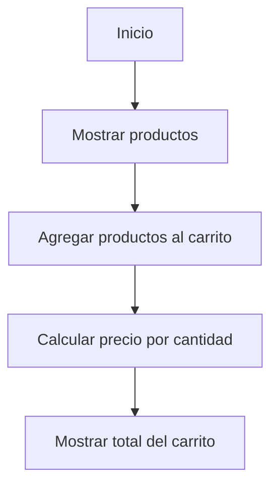

  

## 1. Descripción del proyecto

Tienda TECSUP es una aplicación web que simula un carrito de compras, donde los usuarios pueden visualizar productos, precios y cantidades, además de calcular el importe total de sus compras.

Está dirigida a personas que desean conocer el funcionamiento de un carrito de compras y a estudiantes que buscan practicar el desarrollo web utilizando HTML, CSS y JavaScript.

## 2. Tabla de contenidos

- [Descripción del proyecto](#1-descripción-del-proyecto)
- [Tecnologías utilizadas](#3-tecnologías-utilizadas)
- [Instalación](#4-instalación)
- [Uso de la aplicación](#5-uso-de-la-aplicación)
- [Funciones principales](#6-funciones-principales)
- [Ejemplos de código](#7-ejemplos-de-código)
- [Hoja de ruta](#8-hoja-de-ruta)
- [Arquitectura](#9-arquitectura)
- [Contribuciones](#10-contribuciones)
- [Licencia](#11-licencia)


## 3. Tecnologías utilizadas

El proyecto utiliza las siguientes tecnologías:

Tecnología| Función
HTML5| Estructura de la página web
CSS3| Diseño y estilos visuales
JavaScript| Cálculos y funcionamiento del carrito
Git| Control de versiones
GitHub| Almacenamiento del repositorio

## 4. Instalación

Para obtener el proyecto, sigue estos pasos:

1. Clonar el repositorio:

git clone https://github.com/mariaquispev-dot/tienda-tecsup.git

2. Ingresar a la carpeta:

cd tienda-tecsup

3. Abrir el proyecto:

Abre el archivo "index.html" en tu navegador para visualizar la aplicación.

## 5. Uso de la aplicación

1. Abrir el archivo "index.html" en el navegador.
2. Visualizar los productos disponibles.
3. Revisar las cantidades y los precios.
4. Comprobar el importe total del carrito.

## 6. Funciones principales

Función| Descripción
calcularTotal()| Calcula el importe total del carrito.
Multiplicar precio por cantidad| Calcula el importe correspondiente a cada producto.
Mostrar carrito| Presenta los productos, cantidades y precios.

## 7. Ejemplos de código

JavaScript: cálculo del total

```javascript
function calcularTotal(lista) {
    let total = 0;

    for (const producto of lista) {
        total += producto.precio * producto.cantidad;
    }

    return total;
}
```

HTML: estructura de la tienda

```html

<h1>Tienda TECSUP</h1>

<table>
    <tr>
        <th>Producto</th>
        <th>Precio</th>
        <th>Cantidad</th>
    </tr>
</table>
```

## 8. Hoja de ruta

- [x] Crear la estructura HTML.
- [x] Diseñar la página con CSS.
- [x] Corregir el cálculo del total del carrito.
- [x] Corregir la referencia del archivo de estilos.
- [x] Crear Issues para reportar errores.
- [x] Crear ramas para realizar correcciones.
- [x] Enviar Pull Requests.
- [ ] Incorporar nuevas funcionalidades.
- [ ] Mejorar el diseño de la tienda.

## 9. Arquitectura

El proyecto se organiza mediante los siguientes pasos:



## 10. Contribuciones

Si deseas colaborar con el proyecto, puedes reportar errores, proponer mejoras y enviar cambios mediante Pull Requests.

Antes de realizar modificaciones, revisa nuestra guía de contribución:

👉 [Leer la guía de contribución (CONTRIBUTING.md)](CONTRIBUTING.md)
## 11. Licencia

Este proyecto utiliza la licencia MIT, de acuerdo con el archivo LICENSE del repositorio.

---

Proyecto desarrollado como parte del Laboratorio N.º 3: Trabajo colaborativo con repositorios remotos.